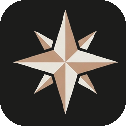

<div align="center">
  
  <h1>Archive Hub</h1>
  <p>
    <strong>할 일 · 일정 · 학교 생활 · Gemini AI · 집중 타이머를 하나로 모은 미니멀 데스크톱 위젯</strong>
  </p>
  <p>
    
    
    
  </p>
</div>

---

## ✨ 주요 기능 (12개 탭)

| # | 탭 | 설명 |
| :-: | :--- | :--- |
| 1 | **메인 요약** (`home`) | 오늘 기준 +7일 주간 스트립과 핵심 할 일·일정·시험 요약 |
| 2 | **할 일 & 일정** (`todo`) | 스마트 입력(`14:00 미팅 #학업`), 드래그 파일 첨부, 주간 반복, D-Day 배지, 완료 축하 폭죽 & 레인보우 테두리 |
| 3 | **달력** (`calendar`) | 월간 캘린더 뷰에서 날짜별 일정·마감일 탐색 및 빠른 추가 |
| 4 | **공부 & 시험** (`study`) | 시험 D-Day 카드, 과목별 주간 학습 루틴 및 진도 관리 |
| 5 | **일일 리포트** (`reports`) | 지정 폴더의 일일 리포트 열람 및 미확인 알림 표시 |
| 6 | **학교 공지** (`notices`) | 학교 공지사항 자동 동기화(15분 간격) 및 새 공지 개수 배지 |
| 7 | **학교 메일** (`mail`) | Gmail IMAP 연동(1시간 간격) 및 읽지 않은 메일 알림 |
| 8 | **바로가기** (`links`) | 웹 링크, 설치된 데스크톱 앱(Gemini, Claude, ChatGPT 등), 폴더 드래그 앤 드롭 런처 |
| 9 | **Gemini** (`gemini`) | 위젯 내 Gemini 멀티모달 채팅 (`/` 빠른 명령어, `+` 파일/이미지 첨부) |
| 10 | **텍스트 메모** (`memo`) | 자동 저장 멀티 노트 스크래치패드 |
| 11 | **파일 바로가기** (`files`) | 파일·폴더 드래그 앤 드롭, 경로/URL 등록으로 자주 쓰는 파일 즉시 실행 |
| 12 | **집중 타이머** (`pomodoro`) | `5분 · 15분 · 25분 · 50분` 컬러 프리셋, `직접` 분 입력, 완료 시 창 자동 복원 및 최대 20초 멜로디 알람 |

---

## 🛠 공통 편의 기능

- **상단 D-Day 배지**: 여러 D-Day를 등록·전환하며 남은 일수 상시 확인
- **Spotify 미니 플레이어**: 현재 재생 곡 표시 및 이전/재생·일시정지/다음 곡 컨트롤
- **항상 위 고정 & 투명도 조절**: 핀 버튼으로 위젯을 화면 최상단에 고정하고 설정 드로어에서 투명도 조절
- **탭 순서 커스터마이징**: 상단 `6×2` 탭 버튼을 드래그해 원하는 순서로 재배치 (자동 저장)

---

## ⌨️ 단축키

| 단축키 | 동작 |
| :--- | :--- |
| `Alt + Shift + W` | 위젯 창 표시 / 숨김 토글 (글로벌 단축키) |
| `Ctrl + 1 ~ 9` | 1번 ~ 9번 탭으로 바로 이동 |
| `Ctrl + 0` / `Ctrl + -` / `Ctrl + =` | 10번 / 11번 / 12번 탭으로 이동 |
| `Tab` / `Shift + Tab` | 다음 / 이전 탭 전환 |

---

## 📁 프로젝트 구조

```text
Archive-Hub/
├── main.js                   # Electron 메인 프로세스, 창/트레이/글로벌 단축키, IMAP·Gemini·파일 IPC
├── preload.js                # contextBridge API 노출
├── index.html                # 위젯 레이아웃 및 12개 탭 마크업
├── styles.css                # 다크 미니멀 테마 및 애니메이션 스타일
├── renderer.js               # 탭 상태, 할 일/달력/타이머/Gemini UI 로직
├── scripts/
│   └── spotify-status.ps1    # Windows Spotify 재생 상태 연동 스크립트
├── assets/icons/             # 앱 및 바로가기 아이콘 리소스
├── MyDeskHub.vbs             # 콘솔 창 없이 백그라운드 실행용 런처
└── package.json              # 프로젝트 메타데이터 및 실행 스크립트
```

---

## 🚀 실행 방법

```bash
# 의존성 설치
npm install

# 위젯 실행
npm start
```

> **참고:** Windows에서 콘솔 창 없이 실행하려면 `MyDeskHub.vbs`를 사용할 수 있으며, 위젯 설정에서 **Windows 시작 시 자동 실행**도 켤 수 있습니다.
